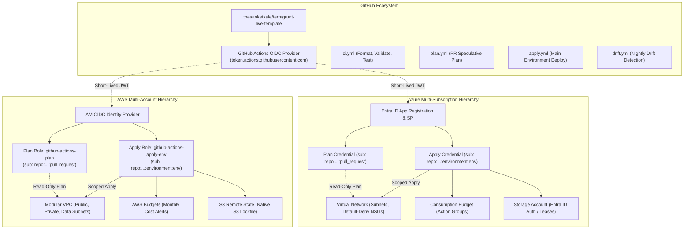

# terragrunt-live-template

Multi-environment Terragrunt baseline for AWS and Azure: remote state, GitHub OIDC federation without stored secrets, network and budget modules, and plan, apply and drift-detection pipelines.

[](https://github.com/thesanketkale/terragrunt-live-template/actions/workflows/ci.yml)
[](https://github.com/thesanketkale/terragrunt-live-template/releases)
[](LICENSE)

---

## 1. Why It Exists

Managing multi-tier infrastructure across multiple public clouds frequently leads teams into one of two traps: either sprawling, copy-pasted Terraform configurations where remote backend definitions and provider blocks are duplicated across dozens of folders, or opaque, monolithic landing-zone frameworks that are too rigid for modern agile workloads.

`terragrunt-live-template` solves this by providing a clean, modular foundation:
- **Zero Stored Credentials:** All CI/CD workflows authenticate exclusively through short-lived GitHub Actions OpenID Connect (OIDC) tokens—no static access keys or client secrets stored in GitHub secrets.
- **DRY Multi-Cloud Architecture:** Terragrunt dynamically generates remote backend and provider configurations for both AWS and Azure using a single `root.hcl` root file.
- **Fail-Fast Offline Testability:** Every module ships with native `terraform test` (`*.tftest.hcl`) utilizing `mock_provider` for complete offline test execution without requiring cloud credentials.

### Honest Comparison with Existing Alternatives

| Feature / Aspect | `terragrunt-live-template` | Vanilla Terraform Workspaces | Gruntwork Reference Architecture | Cloud Posse Components |
| :--- | :--- | :--- | :--- | :--- |
| **Multi-Cloud Support** | AWS and Azure unified in one DRY hierarchy | Manual provider blocks per cloud | AWS-first (Azure separate / paid) | AWS-centric |
| **Credential Management** | 100% OIDC federated (no stored keys) | Often relies on stored static keys | OIDC supported via boilerplate | OIDC via Atmos/Spacelift |
| **State Locking** | Native S3 lockfile (TF 1.10+) / Entra ID leases | DynamoDB table per account required | DynamoDB state tables | DynamoDB state tables |
| **License & Portability** | Open-source MIT, OpenTofu & Terraform dual support | Terraform native only | Proprietary commercial subscription | Open-source (Atmos orchestrator) |
| **Offline Testability** | 100% offline via native `terraform test` | Manual mocking or localstack | Terratest (requires live cloud API) | Terratest against live sandbox |

---

## 2. Features

- **Multi-Cloud Orchestration:** Unified Terragrunt hierarchy supporting AWS (`live/aws/...`) and Azure (`live/azure/...`).
- **OpenTofu & Terraform Dual Support:** Compatible out-of-the-box with both Terraform (>= 1.10.x) and OpenTofu (>= 1.8.x).
- **Modern State Backend & Locking:**
  - **AWS:** Amazon S3 with native S3 lockfile (`use_lockfile = true`) eliminating DynamoDB table costs, with DynamoDB fallback toggle.
  - **Azure:** Azure Blob Storage with Entra ID token authentication (shared keys disabled) and lease locking.
- **GitHub OIDC Least-Privilege Identity:** Separate read-only **Plan** role (pull requests) and environment-scoped **Apply** role (`dev`, `stage`, `prod`).
- **Modular Networking:**
  - AWS VPC across 2-3 AZs with public, private, and data subnets; single-NAT cost toggle; free VPC Gateway endpoints for S3 and DynamoDB.
  - Azure VNet with segmented subnets, default-deny Network Security Groups, and optional NAT Gateway.
- **Automated Cost Control:** Multi-threshold monthly budget alerts (50%, 80%, 100%) via AWS Budgets and Azure Consumption Budgets.
- **Automated Pipelines:** GitHub Actions for PR speculative plan sticky comments, environment-approved applies, and nightly drift detection.

---

## 3. Quickstart

Run these five commands from a clean machine with Terraform and Terragrunt installed:

```bash
# 1. Clone the repository
git clone https://github.com/thesanketkale/terragrunt-live-template.git && cd terragrunt-live-template

# 2. Run clean-room and secret scanner
./tools/guard.sh # Or in PowerShell: .\tools\guard.ps1

# 3. Verify HCL formatting across all stacks
./scripts/verify.sh fast # Or in PowerShell: .\scripts\verify.ps1 fast

# 4. Run the full offline test suite across all 8 modules (no cloud credentials required)
./scripts/verify.sh full # Or in PowerShell: .\scripts\verify.ps1 full

# 5. Generate a dry-run speculative plan on an isolated stack (offline with mock outputs)
cd live/aws/111111111111/us-east-1/dev/network && terragrunt plan
```

---

## 4. Architecture Overview



---

## 5. Configuration Reference

| Parameter / Variable | Module / Level | Default | Purpose |
| :--- | :--- | :--- | :--- |
| `bucket_name` | `aws/state-backend` | Dynamic | Globally unique S3 bucket name for state storage. |
| `use_lockfile` | `root.hcl` | `true` | Enables Terraform 1.10+ native S3 state locking without DynamoDB. |
| `create_dynamodb_lock_table` | `aws/state-backend` | `false` | Fallback toggle to provision DynamoDB lock table for legacy Terraform < 1.10. |
| `single_nat_gateway` | `aws/network` | `true` (dev/stage) | Limits NAT Gateways to 1 in non-prod environments to minimize idle cost. |
| `enable_nat_gateway` | `azure/network` | `true` | Provisions Azure NAT Gateway for deterministic outbound internet egress. |
| `shared_access_key_enabled` | `azure/state-backend`| `false` | Enforces Entra ID authentication on state storage accounts. |
| `github_org` | `github-oidc` | `"thesanketkale"`| GitHub organization or user owning the repository. |
| `github_repo` | `github-oidc` | `"terragrunt-live-template"` | GitHub repository name for subject-claim scoping. |
| `budget_limit` | `env.hcl` | `$50` (dev), `$150` (stage), `$500` (prod) | Monthly spend limit triggering automated alerts. |

---

## 6. Usage Examples

### Deploying an Isolated Dev Stack
```bash
# Navigate to the target leaf directory
cd live/aws/111111111111/us-east-1/dev/network

# Review the speculative plan
terragrunt plan

# Apply changes (owner-verified with write credentials)
terragrunt apply
```

### Running All Stacks in an Environment
```bash
# Navigate to environment folder
cd live/aws/111111111111/us-east-1/dev

# Run plan across all dependent stacks in topological order
terragrunt run-all plan
```

---

## 7. Troubleshooting and FAQ

#### Q: How does Terragrunt resolve dependencies when running `plan` or `validate` offline?
Every `dependency` block in `live/.../terragrunt.hcl` specifies a `mock_outputs` block with dummy outputs (e.g., `vpc_id = "vpc-mock123"`). Terragrunt automatically substitutes mock outputs during `validate` and `plan` operations when state does not yet exist.

#### Q: Why does Terragrunt syntax differ between versions (`run-all` vs `run --all`)?
Terragrunt evolved its CLI syntax in v0.64+. To guarantee forward and backward compatibility, all repository scripts (`scripts/verify.sh`, CI workflows) test and support both command formats:
```bash
terragrunt hcl fmt --check 2>/dev/null || terragrunt hclfmt --terragrunt-check
```

#### Q: How do I switch between Terraform and OpenTofu?
Simply export `TERRAGRUNT_TFPATH`:
```bash
# Use OpenTofu
export TERRAGRUNT_TFPATH="tofu"

# Use Terraform
export TERRAGRUNT_TFPATH="terraform"
```

---

## 8. Security Notes & Known Limitations

- **Least-Privilege Workflows:** GitHub Actions workflows define top-level `permissions: {}` and grant minimal scopes per job.
- **SHA-Pinned Actions:** Third-party GitHub Actions are strictly pinned to immutable 40-character commit SHAs.
- **Clean-Room Enforcement:** Zero references to client projects, private companies, or real credentials exist in the codebase.
- **Known Limitations (v0.1.0):**
  - Workload application services (ECS Fargate / Azure Container Apps) are deferred to Phase 2 (post-v1.0).
  - Multi-tenant landing-zone control towers (AWS Control Tower, Azure Landing Zones) are out of scope.

---

## 9. Verification Status

| Capability / Check | CI Automated Status | Owner-Verified Status | Documentation Reference |
| :--- | :--- | :--- | :--- |
| **Clean-Room Compliance** | :white_check_mark: Passing | N/A | `tools/guard.sh` |
| **HCL & Terraform Formatting** | :white_check_mark: Passing | N/A | `scripts/verify.sh` |
| **Static Analysis (TFLint)** | :white_check_mark: Passing | N/A | `.tflint.hcl` |
| **Module Tests (`mock_provider`)** | :white_check_mark: Passing | N/A | `modules/*/tests/*.tftest.hcl` |
| **AWS Live OIDC Bootstrap** | N/A (Needs Live Cloud) | ⏳ Owner Verification | [`docs/verification-log.md`](docs/verification-log.md) |
| **Azure Live OIDC Bootstrap** | N/A (Needs Live Cloud) | ⏳ Owner Verification | [`docs/verification-log.md`](docs/verification-log.md) |
| **Live PR Plan & Apply** | N/A (Needs Live Cloud) | ⏳ Owner Verification | [`docs/verification-log.md`](docs/verification-log.md) |
| **Nightly Drift Detection** | N/A (Needs Live Cloud) | ⏳ Owner Verification | [`docs/verification-log.md`](docs/verification-log.md) |

---

## 10. Roadmap, Contributing & Licence

- [x] Multi-cloud remote state backend with native locking (AWS S3 & Azure Blob).
- [x] Zero-secret GitHub Actions OIDC federation for Plan and Apply.
- [x] Multi-AZ VPC and VNet networking modules with cost toggles.
- [x] Automated multi-threshold budget alerts for AWS and Azure.
- [x] Offline native `terraform test` validation suites with `mock_provider`.
- [ ] Phase 2: Workload container service modules (ECS Fargate & Azure Container Apps).
- [ ] Phase 3: Automated drift remediation actions.

Contributions are welcome! Please read [CONTRIBUTING.md](CONTRIBUTING.md) and our [Code of Conduct](CODE_OF_CONDUCT.md).

Licensed under the [MIT License](LICENSE). Copyright (c) 2026 Sanket Kale.

---

## 11. Related Projects

- **[`reusable-workflows`](https://github.com/thesanketkale/reusable-workflows):** Versioned, least-privilege GitHub Actions workflow library for .NET, Node, PHP, Docker, and Terraform.
- **[`php-api-foundation`](https://github.com/thesanketkale/php-api-foundation):** PHP 8.3 REST API foundation with JWT auth, PDO migrations, OpenAPI contract, and OIDC cloud deployments.
- **[`dotnet-web-foundation`](https://github.com/thesanketkale/dotnet-web-foundation):** Modular ASP.NET Core web application foundation with Identity, user profiles, admin CMS, EF Core, and hardened containers.
