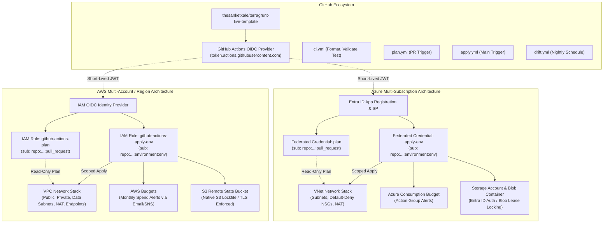
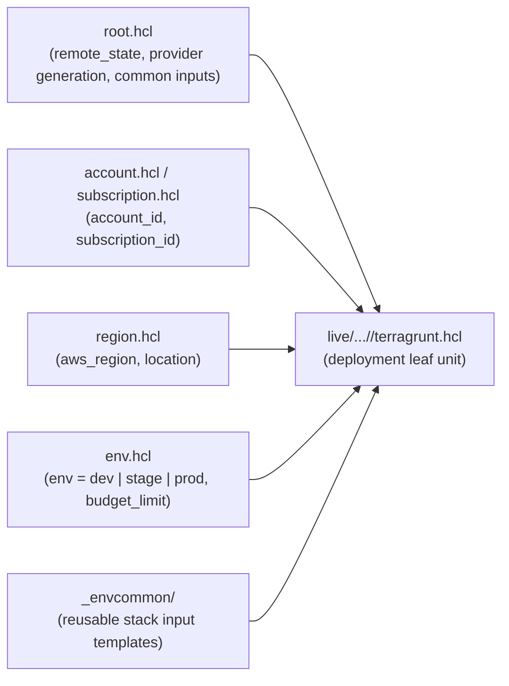

# Architecture Specification: terragrunt-live-template

## Executive Summary

`terragrunt-live-template` provides a production-hardened, multi-cloud Infrastructure-as-Code (IaC) baseline supporting both Amazon Web Services (AWS) and Microsoft Azure. Built on **Terragrunt** with native **Terraform** and **OpenTofu** engine compatibility, the architecture enforces DRY principles across accounts, regions, and environments while completely eliminating static credentials via OpenID Connect (OIDC) identity federation.

---

## High-Level Architecture Diagram

---

## Directory Hierarchy & Inheritance Model

Terragrunt keeps infrastructure definitions DRY by reading hierarchical configuration files dynamically at runtime using `find_in_parent_folders()`:

### Inheritance Resolution Flow
1. **`root.hcl`**: Located at the repository root. Defines:
   - Dynamic backend generation: Configures AWS S3 or Azure Blob remote state with automatic key names matching the directory path.
   - Provider generation: Generates `provider "aws"` or `provider "azurerm"` with default tags and region parameters.
2. **`account.hcl` / `subscription.hcl`**: Located under `live/<cloud>/<account_id>/`. Injects account identifiers and shared account tags.
3. **`region.hcl`**: Located under `live/<cloud>/<account_id>/<region>/`. Injects region identifiers (e.g., `us-east-1`, `eastus`).
4. **`env.hcl`**: Located under `live/<cloud>/<account_id>/<region>/<env>/`. Sets environment tier (`dev`, `stage`, `prod`), cost center tags, and budget thresholds.
5. **`_envcommon/<stack>.hcl`**: Encapsulates common inputs and module source paths for reusable stacks (`network`, `github-oidc`, `state-backend`, `budget-alerts`).
6. **`terragrunt.hcl`**: The deployment leaf unit. Includes `root.hcl` and `_envcommon/<stack>.hcl`, overriding only environment-specific variables.

---

## Stack Modules Breakdown

| Module | Cloud | Description | Key Security & Operational Controls |
| :--- | :--- | :--- | :--- |
| `state-backend` | AWS | Amazon S3 remote state bucket with native locking. | Versioning enabled, AES256/KMS encryption, Public Access Block, TLS-only bucket policy, `prevent_destroy = true`, native S3 lockfile (`use_lockfile = true`) with DynamoDB fallback. |
| `state-backend` | Azure | Azure Blob Storage remote state account & container. | TLS 1.2 minimum, Shared Key Access disabled (Entra ID auth only), blob versioning, soft delete, lease-based locking, `prevent_destroy = true`. |
| `github-oidc` | AWS | IAM OIDC Identity Provider and Plan/Apply roles. | Cryptographic thumbprint pinning, subject claim scoping (`pull_request` vs `environment:<env>`), read-only plan policy vs scoped apply policy. |
| `github-oidc` | Azure | Entra ID App, Service Principal & Federated Credentials. | Federated identity credentials for PR and environment subjects, Reader + Storage Blob Data Reader for plan, scoped Contributor for apply. |
| `network` | AWS | Modular VPC across 2-3 Availability Zones. | Public, Private, and Data isolated subnets; Single-NAT Gateway cost toggle; VPC Gateway Endpoints for S3 and DynamoDB. |
| `network` | Azure | Virtual Network with subnet segmentation. | Public (frontend), Private (app), Data (isolated database) subnets; Default-deny NSG rules with explicit allow rules; Optional NAT Gateway. |
| `budget-alerts` | AWS | AWS Budgets with multi-threshold alerts. | Monthly spend tracking; 50%, 80%, 100% threshold notifications via Email and SNS. |
| `budget-alerts` | Azure | Azure Consumption Budget with Action Groups. | Monthly spend tracking; Email notifications via Azure Monitor Action Groups. |

---

## CI/CD Pipeline & OIDC Workflow Lifecycle

### 1. Verification Pipeline (`ci.yml`)
- Executes on every pull request and push to `main`.
- Runs:
  - Repository clean-room and secret guard (`tools/guard.sh`).
  - HCL formatting check (`terragrunt hclfmt --terragrunt-check` or `hcl fmt --check`).
  - Terraform formatting check (`terraform fmt -check -recursive`).
  - Terraform module validation (`terraform validate` across all modules).
  - TFLint static analysis with AWS and Azure rulesets.
  - Native `terraform test` using `mock_provider` across all modules (zero cloud credentials required).
  - Gitleaks full-history security scan.

### 2. Plan Pipeline (`plan.yml`)
- Triggers on pull requests modifying files in `live/**` or `modules/**`.
- Detects affected live stacks via git diff.
- Authenticates to AWS / Azure via GitHub Actions OIDC using the **Plan Role** (`sub: repo:thesanketkale/terragrunt-live-template:pull_request`).
- Runs `terragrunt plan` on affected stacks.
- Posts a formatted, collapsed plan summary as a sticky pull request comment.

### 3. Apply Pipeline (`apply.yml`)
- Triggers on merges to `main` or manual `workflow_dispatch`.
- Binds to GitHub Environments (`dev`, `stage`, `prod`):
  - `dev`: Applies automatically upon merge.
  - `stage`: Requires staging team review/approval.
  - `prod`: Requires production approver sign-off.
- Authenticates to AWS / Azure via GitHub Actions OIDC using the **Apply Role** (`sub: repo:thesanketkale/terragrunt-live-template:environment:<env>`).
- Executes `terragrunt apply` with per-environment concurrency controls.

### 4. Nightly Drift Detection Pipeline (`drift.yml`)
- Executes on a nightly schedule (`cron: "0 2 * * *"`) or manual trigger.
- Runs `terragrunt plan -detailed-exitcode` against production stacks.
- If exit code `2` (infrastructure drift detected) is returned, automatically creates or updates an actionable GitHub issue with the drift diff.
