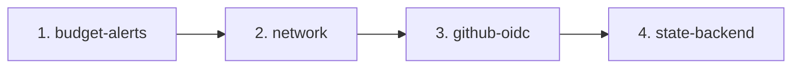

# Teardown & Destroy Runbook

> [!CAUTION]
> Destroy operations are destructive and irreversible. Agents never execute destroy commands. All teardowns must be performed manually by repository owners.

---

## 1. Safety Rules & Teardown Order

To prevent orphaned resources and dependency lockups, tear down stacks in reverse dependency order:



1. **`budget-alerts`**: Remove monitoring and alert bindings.
2. **`network`**: Remove VPC/VNet, NAT Gateways, Elastic IPs, and subnets.
3. **`github-oidc`**: Remove IAM roles and federated credentials once workloads are deleted.
4. **`state-backend`**: Requires explicit removal of `prevent_destroy = true` lifecycle blocks and emptying versioned storage buckets/containers.

---

## 2. Handling `prevent_destroy` on State Resources

Both `aws_s3_bucket.state` and `azurerm_storage_account.state` declare:
```hcl
lifecycle {
  prevent_destroy = true
}
```

Attempting to run `terraform destroy` or `terragrunt destroy` while this block is present will deliberately fail with an error:
```
Error: Instance cannot be destroyed by terraform: Resource has lifecycle.prevent_destroy set
```

To permanently decommission a state backend:
1. Ensure all workloads and state files have been archived or deleted.
2. Temporarily set `prevent_destroy = false` or comment out the lifecycle block.
3. Empty all versioned objects from the S3 bucket or blob container.
4. Execute `terragrunt destroy`.
